# RISC-V Architecture and Programming Workshop

### Hands-on Learning | C Programming | RISC-V Cross Compilation | Assembly | Spike Simulation

**Repository Owner:** Ananya Mathapati  
**Domain:** VLSI Design | Computer Architecture | RISC-V  
**Workshop:** RISC-V Hands-on Workshop  
**Platform:** Ubuntu Linux (VirtualBox)

---

## 1. About This Repository

This repository documents my practical learning and hands-on experiments during the RISC-V workshop.

The objective is to understand the fundamentals of RISC-V architecture, explore the compilation process, examine generated assembly instructions, and execute RISC-V programs using the Spike RISC-V ISA simulator.

Instead of simply documenting theoretical concepts, this repository captures the actual commands, source codes, compilation results, debugging experiences and terminal outputs obtained during the workshop.

All experiments are independently documented based on my learning and practical execution.

---

## 2. Learning Objectives

- Understand the RISC-V instruction set architecture.
- Explore C programming in a Linux environment.
- Understand native GCC compilation.
- Perform cross-compilation using the RISC-V GNU toolchain.
- Understand the relationship between C source code and RISC-V assembly.
- Explore compiler optimization using compilation flags.
- Examine generated assembly and disassembly.
- Execute RISC-V binaries using Spike and the Berkeley Boot Loader (BBL).
- Understand signed and unsigned integer representations.
- Explore integer limits and boundary conditions.
- Debug compilation errors and observe program execution.

---

## 3. Development Environment

| Component | Tool / Platform |
|---|---|
| Operating System | Ubuntu Linux |
| Virtualization | Oracle VirtualBox |
| Programming Language | C |
| Native Compiler | GCC |
| Cross Compiler | riscv64-unknown-elf-gcc |
| Architecture | RV64I |
| ABI | LP64 |
| Simulator | Spike |
| Proxy Kernel | pk |
| Terminal Editor | Vim / Nano |

---

## 4. Day 1 – Practical Experiments

### Experiment 1: C Programming – Sum of Natural Numbers

**Objective:** To write and execute a C program that calculates the sum of natural numbers from 1 to 5.

**Source Code:**

```c
#include <stdio.h>

int main()
{
    int i, sum = 0, n = 5;

    for(i = 0; i <= n; ++i)
    {
        sum += i;
    }

    printf("Sum of numbers from 1 to %d is %d\n", n, sum);

    return 0;
}
```

**Compilation using Native GCC:**

```bash
gcc sum1ton.c
```

**Execution:**

```bash
./a.out
```

**Output:**

```text
Sum of numbers from 1 to 5 is 15
```

**Observation:** The program was successfully compiled and executed using the native GCC compiler.

### Experiment 2: Exploring the Linux Environment

The Linux terminal was used to navigate directories and inspect files generated during compilation.

**Commands used:**

```bash
cd
ls -ltr
cat sum1ton.c
```

**Learning:** Understanding the Linux working directory, file permissions, file listing and source-code inspection.

### Experiment 3: RISC-V Cross Compilation

**Objective:** To compile a C program for the RISC-V architecture using the RISC-V GNU toolchain.

**Compiler command:**

```bash
riscv64-unknown-elf-gcc -O0 -mabi=lp64 -march=rv64i -o sum1ton.o sum1ton.c
```

**Explanation:**

- `riscv64-unknown-elf-gcc` – RISC-V cross compiler.
- `-O0` – Disables compiler optimization.
- `-mabi=lp64` – Specifies the LP64 application binary interface.
- `-march=rv64i` – Targets the RV64I base integer instruction set.
- `-o sum1ton.o` – Specifies the output filename.
- `sum1ton.c` – Input C source file.

The generated RISC-V executable was checked using:

```bash
ls -ltr sum1ton.o
```

### Experiment 4: Understanding Assembly and Disassembly

The compiled RISC-V executable was examined to understand the instructions generated by the compiler.

**Concepts explored:**

- RISC-V assembly instructions.
- Register operations.
- Immediate values.
- Branch instructions.
- Jump instructions.
- Function calls and return instructions.
- Program entry and exit.
- Compiler-generated instructions.

The disassembly output provided insight into how a high-level C program is translated into machine-level instructions.

### Experiment 5: Executing RISC-V Programs Using Spike

**Objective:** To execute the compiled RISC-V program using the Spike ISA simulator.

**Command:**

```bash
spike pk sum1ton.o
```

**Observed output:**

```text
bbl loader
Sum of numbers from 1 to 100 is 5050
```

**Debugging using Spike:**

```bash
spike -d pk sum1ton.o
```

The debugging environment was explored using commands such as:

```text
reg 0 a2
```

This helped inspect register values during execution.

### Experiment 6: Understanding Unsigned Integer Limits

A practical experiment was performed to understand the maximum value represented by unsigned integer data types.

**Concepts explored:**

- Unsigned integer representation.
- Maximum representable values.
- Integer data-type limits.
- Boundary-value testing.
- Effect of changing data types.

**Observed terminal output:**

```text
Highest number represented by unsigned long long int max is 18446744073709551615
```

Further experiments were performed by modifying the source code and observing the output for different integer limits.

### Experiment 7: Understanding Signed Integer Limits

This experiment focused on signed integer representation and the minimum and maximum values supported by a signed data type.

**Concepts explored:**

- Signed integer representation.
- Positive and negative number limits.
- Minimum and maximum representable values.
- Data-type modification.
- Compilation errors and debugging.

**Observed output:**

```text
Highest number represented by long long int is 9223372036854775807
Lowest number represented by long long int is -9223372036854775808
```

The experiment helped demonstrate the range of a signed 64-bit integer.

---

## 5. Practical Commands Reference

| Command | Purpose |
|---|---|
| `gcc filename.c` | Native C compilation |
| `./a.out` | Execute native binary |
| `cd` | Navigate to home directory |
| `ls -ltr` | List files by modification time |
| `cat filename.c` | Display source code |
| `vim filename.c` | Edit source code |
| `riscv64-unknown-elf-gcc` | RISC-V cross compilation |
| `spike pk filename.o` | Execute using Spike |
| `spike -d pk filename.o` | Execute in debug mode |

---

## 6. Compilation and Execution Flow

The practical workflow followed during the experiments:

```text
C Source Code
     |
     v
Native GCC Compilation
     |
     v
Native Program Execution
     |
     v
RISC-V Cross Compilation
     |
     v
RISC-V Executable
     |
     v
Assembly / Disassembly Inspection
     |
     v
Spike ISA Simulation
     |
     v
Register Inspection and Debugging
```

---

## 7. Challenges and Debugging

During the practical sessions, I encountered and worked through different issues:

- Typographical errors in terminal commands.
- Incorrect compiler optimization flag usage.
- Source-code syntax errors.
- Understanding the RISC-V cross-compilation command.
- Inspecting generated executable files.
- Learning how to use Spike debug mode.
- Understanding register inspection.
- Testing signed and unsigned integer boundaries.

These practical issues helped improve my understanding of Linux commands, compilation workflows and debugging techniques.

---

## 8. Practical Evidence – Terminal Screenshots

The following screenshots document my actual hands-on work and terminal execution results.

### 01. Native GCC Compilation and Execution
...
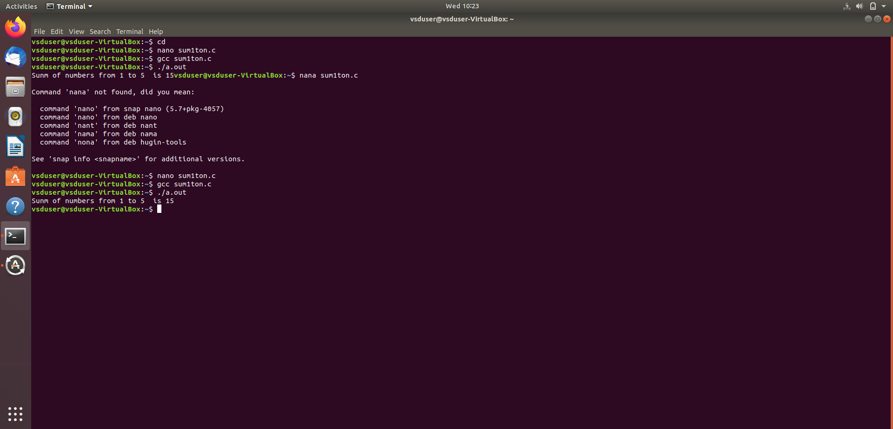

### 02. Linux Directory and File Exploration
....
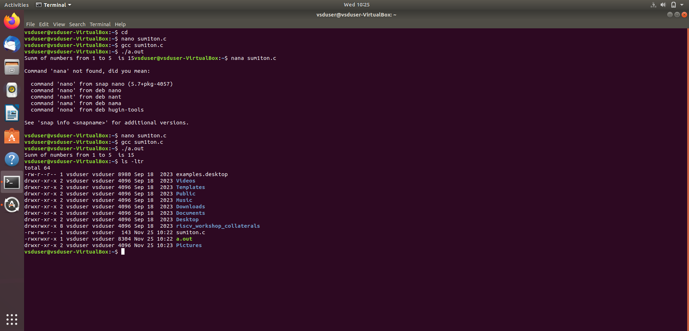
### 03. C Source Code and RISC-V Cross Compilation
...
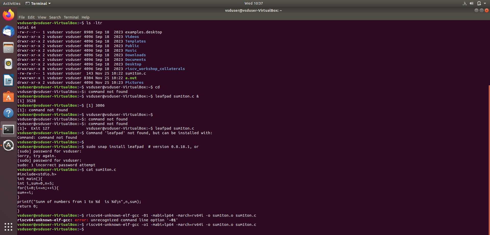

### 04. Assembly and Disassembly Exploration – Part 1

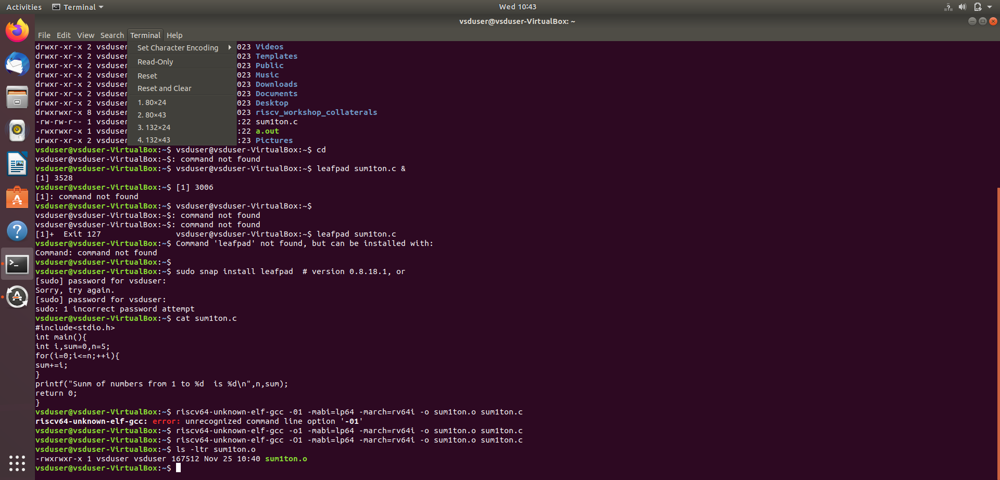

### 05. Assembly and Disassembly Exploration – Part 2

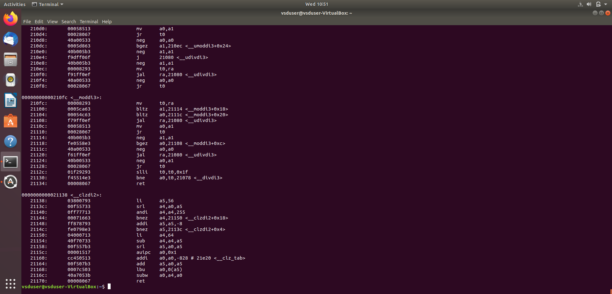

### 06. Main Function and Instruction Inspection

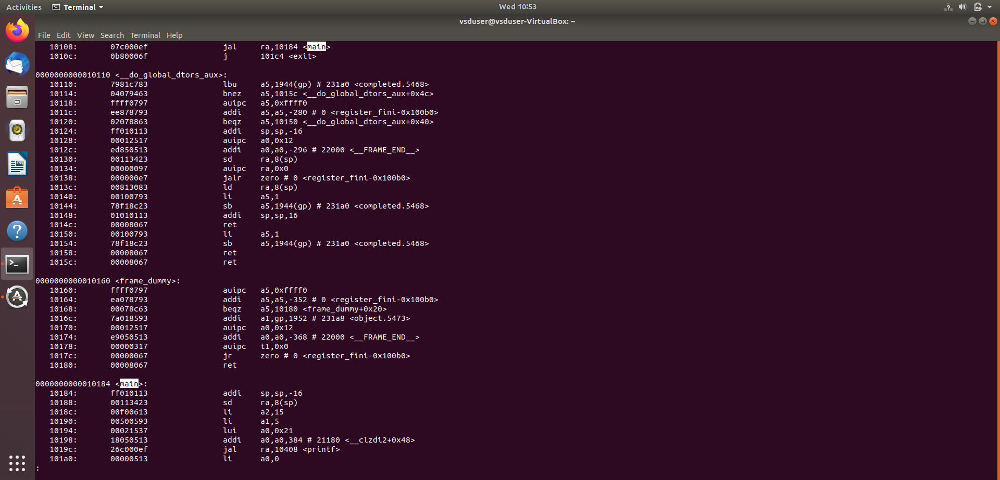

### 07. Program Execution and Instruction Inspection

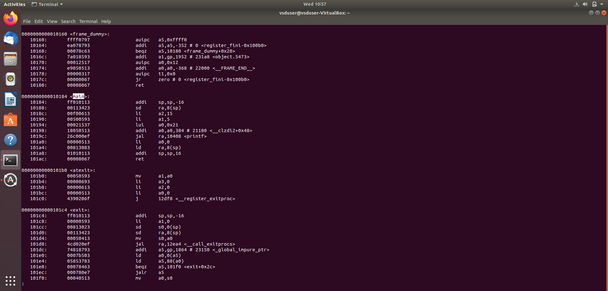

### 08. Spike Simulation and Debugging

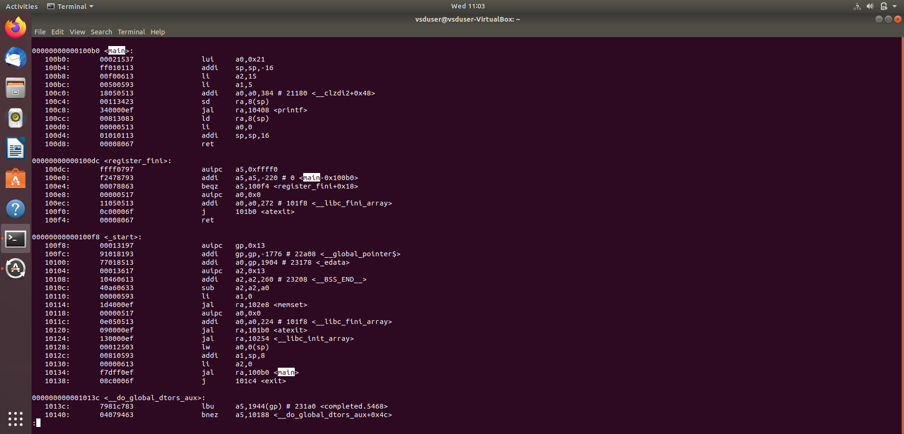

### 09. Unsigned Integer Boundary Experiments

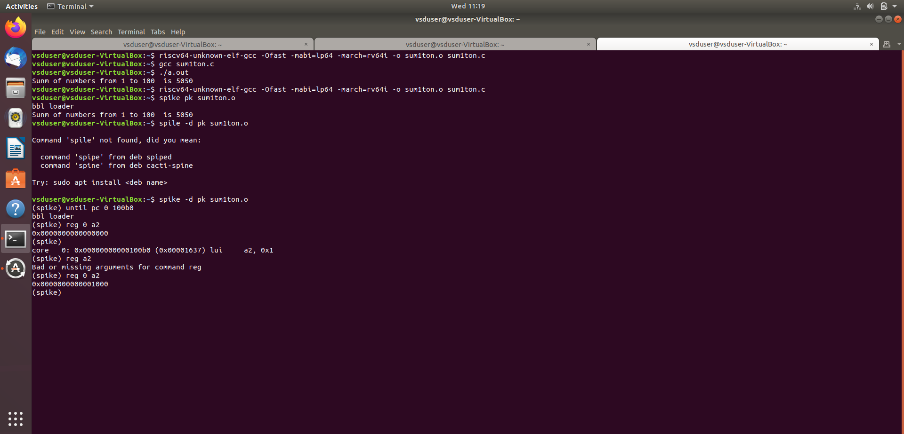

### 10. Signed Integer Compilation and Debugging

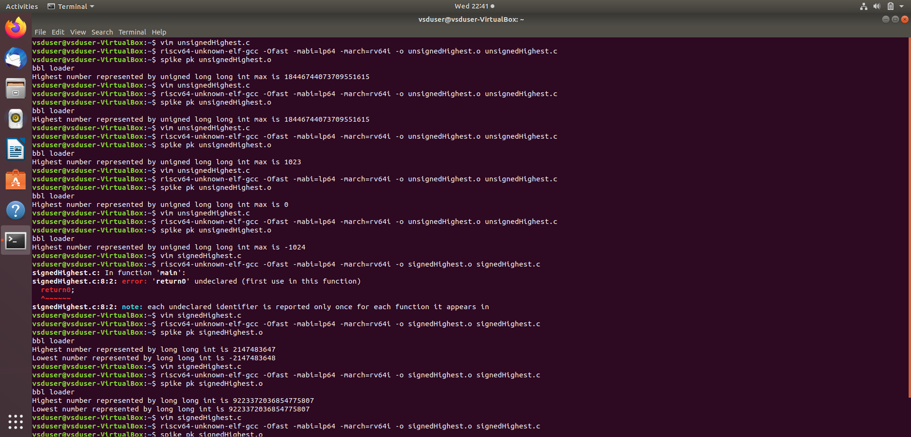

### 11. Signed Integer Boundary Results

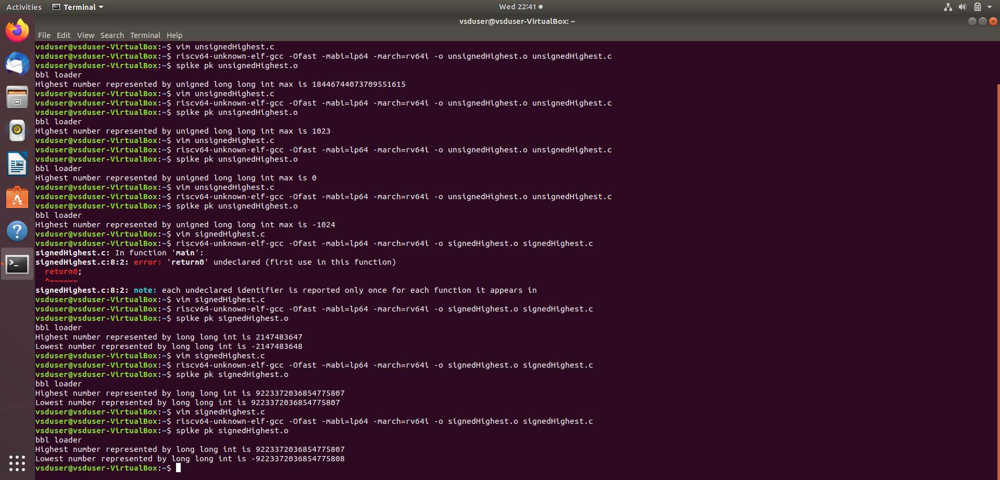
---

## 9. Key Takeaways

Through these hands-on experiments, I developed a practical understanding of:

- C programming and Linux-based development.
- Native compilation versus cross compilation.
- RISC-V compiler configuration.
- Assembly-level program inspection.
- RISC-V ISA simulation using Spike.
- Register-level debugging.
- Signed and unsigned integer representation.
- Compiler errors, debugging and boundary testing.

This workshop provided a foundation for exploring RISC-V architecture, processor internals, computer architecture and hardware-software interaction.

---

## 10. Future Learning

The repository will be progressively updated with additional workshop sessions, experiments, observations and practical implementations as I continue learning RISC-V architecture.

---

**Author:** Ananya Mathapati  
**Focus Areas:** VLSI | Computer Architecture | RISC-V | Physical Design

*Learning by doing. Documenting every experiment. Building a strong foundation in RISC-V.*
