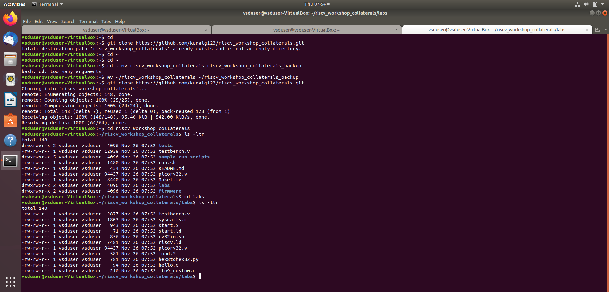
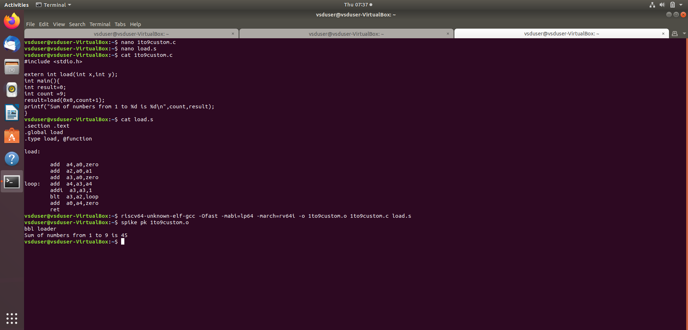
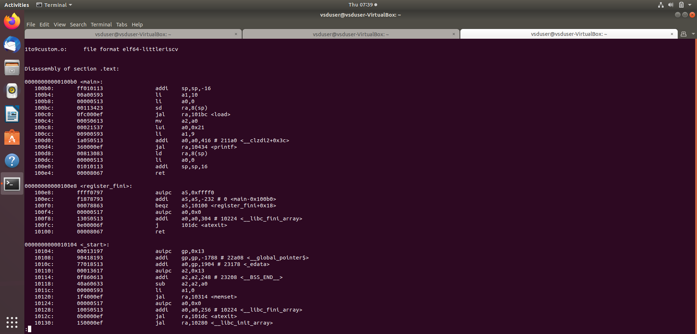

# RISC-V MYTH Workshop – Day 2

### Introduction to ABI, C-to-Assembly Interaction and Basic RTL Verification Flow


---

## 📑 Table of Contents

1. [Overview](#1-overview)
2. [Objectives](#2-objectives)
3. [Workspace Setup and Required Files](#3-workspace-setup-and-required-files)
4. [Understanding the RISC-V ABI](#4-understanding-the-risc-v-abi)
5. [Task 1 – Calling an Assembly Function from C](#5-task-1--calling-an-assembly-function-from-c)
   - [5.1 C Program](#51-c-program)
   - [5.2 Assembly Implementation](#52-assembly-implementation)
   - [5.3 Assembly Instructions](#53-understanding-the-assembly-instructions)
   - [5.4 Disassembly Inspection](#54-understanding-the-function-call-in-disassembly)
   - [5.5 Spike Execution](#55-executing-using-spike)
6. [Task 2 – Running the Program on PicoRV32 RTL](#6-task-2--running-the-program-on-picorv32-rtl)
   - [6.1 PicoRV32 Processor](#61-picorv32-processor)
   - [6.2 Testbench](#62-testbench)
   - [6.3 Memory-Mapped Output](#63-memory-mapped-output)
   - [6.4 Compilation and Simulation Flow](#64-compilation-and-simulation-flow)
   - [6.5 Firmware Generation and Hex Conversion](#65-firmware-generation-and-hex-conversion)
7. [Troubleshooting – PicoRV32 TRAP During Simulation](#7-troubleshooting--picorv32-trap-during-simulation)
8. [Complete Simulation Flow](#8-complete-simulation-flow)
9. [Key Learnings](#9-key-learnings)
10. [Tools Used](#10-tools-used)
11. [Conclusion](#11-conclusion)

---

## 1. Overview

Day 2 of the **RISC-V MYTH Workshop** focuses on understanding the RISC-V Application Binary Interface (ABI), calling conventions, C-to-assembly interaction, debugging using Spike, and executing a RISC-V program on a Verilog-based CPU using Icarus Verilog.

The practical exercises demonstrate how a C program can call an externally implemented assembly function and how the resulting firmware can be executed on the **PicoRV32 processor RTL model**.

The session also introduces the basic RTL simulation flow, firmware generation, memory initialization and debugging of processor-level execution issues.

---

## 2. Objectives

The main objectives of Day 2 were:

- Understand the **RISC-V ABI** and function calling conventions.
- Understand how C programs call assembly functions.
- Write and compile RISC-V assembly code.
- Inspect compiled programs using `objdump`.
- Execute and debug programs using **Spike**.
- Run a RISC-V firmware program on the **PicoRV32 processor**.
- Understand the basic RTL simulation flow using **Icarus Verilog**.

---

## 3. Workspace Setup and Required Files

A separate working directory was created for Day 2 to keep the workshop experiments organised.

### 3.1 Creating the Workspace

```bash
mkdir -p ~/riscv_day2
cd ~/riscv_day2
```

### 3.2 Copying the Required Workshop Files

The required files were copied from the workshop collateral directory:

```bash
cp ~/riscv_workshop_collaterals/labs/{syscalls.c,riscv.ld,start.S,start.ld,hex8tohex32.py,picorv32.v,testbench.v} .
```

### 3.3 Important Files and Their Purpose

| **File** | **Description** |
|---|---|
| `1to9_custom.c` | C program that calls an assembly function. |
| `load.S` | RISC-V assembly implementation of the function. |
| `start.S` | Startup assembly code. |
| `syscalls.c` | System-call support. |
| `riscv.ld` | Linker script. |
| `start.ld` | Startup linker script. |
| `picorv32.v` | PicoRV32 processor RTL. |
| `testbench.v` | Verilog testbench. |
| `hex8tohex32.py` | Converts firmware hex data. |
| `rv32im.sh` | Compilation and simulation script. |

**Figure 1 – Workshop collateral and lab file exploration**



The workshop repository was cloned and its directory structure was explored to identify the required source files, processor RTL, testbench and simulation scripts.

---

## 4. Understanding the RISC-V ABI

The **Application Binary Interface (ABI)** defines how software components interact with one another.

It specifies:

- How function arguments are passed.
- How return values are handled.
- Which registers must be preserved.
- How the stack is managed.
- How functions call and return from other functions.

### 4.1 Important RISC-V Argument and Return Registers

| **Register** | **Purpose** |
|---|---|
| `a0–a7` | Function arguments. |
| `a0–a1` | Return values. |
| `ra` | Return address. |
| `sp` | Stack pointer. |
| `zero` | Constant zero. |
| `s0–s11` | Callee-saved registers. |
| `t0–t6` | Temporary registers. |

**Important:** The first two function arguments are passed through `a0` and `a1`. The return value is generally placed in `a0`.

---

## 5. Task 1 – Calling an Assembly Function from C

The first practical task demonstrates how a C program calls a function implemented separately in RISC-V assembly.

### 5.1 C Program

A C source file named `1to9_custom.c` was created.

The program calls an externally defined assembly function named `load()`.

**Source code:**

```c
#include <stdio.h>

extern int load(int x, int y);

int main()
{
    int result = 0;
    int count = 9;

    result = load(0, count + 1);

    printf("Sum of numbers from 1 to %d is %d\n",
           count, result);

    return 0;
}
```

### Understanding the Function Call

```c
result = load(0, count + 1);
```

The arguments passed to the assembly function are:

| **Argument Register** | **Value** |
|---|---|
| `a0` | `0` |
| `a1` | `10` |

The C program passes these arguments according to the RISC-V ABI calling convention.

### 5.2 Assembly Implementation

A separate assembly file named `load.S` was created to implement the `load()` function.

**Assembly source code:**

```asm
.section .text
.global load
.type load, @function

load:
    add  a4, a0, zero
    add  a2, a0, a1
    add  a3, a0, zero

loop:
    add  a4, a3, a4
    addi a3, a3, 1
    blt  a3, a2, loop

    add  a0, a4, zero
    ret
```

### Understanding the Assembly Logic

The assembly function performs the following operations:

1. Initialises the accumulator.
2. Initialises the loop counter.
3. Adds the current counter value to the accumulator.
4. Increments the counter.
5. Uses the `blt` instruction to repeat the loop while the counter is less than the limit.
6. Returns the calculated result through register `a0`.

The loop adds values from **0 to 9**.

Since adding zero does not change the sum, the final result is:

\[
0+1+2+3+4+5+6+7+8+9=45
\]

### 5.3 Understanding the Assembly Instructions

| **Instruction** | **Operation** |
|---|---|
| `add` | Addition. |
| `addi` | Addition with immediate. |
| `blt` | Branch if less than. |
| `ret` | Return from function. |

**Figure 2 – C program, assembly implementation and Spike execution**



The screenshot shows the C source code, the assembly function and the successful execution result:

**Sum of numbers from 1 to 9 is 45**

### 5.4 Understanding the Function Call in Disassembly

The generated machine instructions can be inspected using:

```bash
riscv64-unknown-elf-objdump -d 1to9_custom.o
```

The disassembly helps verify how the compiler passes arguments and calls the assembly function.

The `jal` instruction transfers control to `load`, while saving the return address in `ra`.

**Figure 3 – RISC-V disassembly and instruction inspection**



The disassembly displays the generated machine instructions, addresses and corresponding assembly operations. It helps understand the interaction between the C program and the separately implemented assembly function.

### 5.5 Executing Using Spike

The compiled program was executed using the RISC-V Spike simulator.

**Execution command:**

```bash
spike pk 1to9_custom.o
```

**Expected terminal output:**

```text
bbl loader
Sum of numbers from 1 to 9 is 45
```

The program successfully executes on Spike and returns the expected sum.

---

## 6. Task 2 – Running the Program on PicoRV32 RTL

The next part involves running the C and assembly program on the **PicoRV32 processor** using Verilog simulation.

### 6.1 PicoRV32 Processor

The file `picorv32.v` contains the RTL implementation of the PicoRV32 RISC-V processor.

The testbench instantiates the processor and provides:

- Clock generation.
- Reset generation.
- Instruction and data memory interface.
- Firmware loading.
- Memory-mapped output.
- Simulation termination.

### 6.2 Testbench

The processor is instantiated in `testbench.v`.

**PicoRV32 instantiation:**

```verilog
picorv32 #(
    .COMPRESSED_ISA(1),
    .ENABLE_MUL(1),
    .ENABLE_DIV(1)
) uut (
    .clk(clk),
    .resetn(resetn),
    .trap(trap),
    .mem_valid(mem_valid),
    .mem_instr(mem_instr),
    .mem_ready(mem_ready),
    .mem_addr(mem_addr),
    .mem_wdata(mem_wdata),
    .mem_wstrb(mem_wstrb),
    .mem_rdata(mem_rdata)
);
```

The processor configuration enables:

- Compressed instruction support.
- Multiplication support.
- Division support.

The memory is initialised using `firmware32.hex`.

### 6.3 Memory-Mapped Output

The testbench uses a memory-mapped address to print characters generated by the firmware.

**Verilog implementation:**

```verilog
if (mem_addr == 32'h1000_0000) begin
    $write("%c", mem_wdata[7:0]);
end
```

This allows the simulated processor to display the program output in the terminal.

### 6.4 Compilation and Simulation Flow

The workshop script `rv32im.sh` performs the following operations:

1. Compiles the C program for RV32IM.
2. Compiles the assembly function.
3. Compiles the system-call support code.
4. Links the firmware.
5. Generates the startup ELF.
6. Converts ELF files into Verilog hex format.
7. Converts firmware hex data into 32-bit format.
8. Compiles the PicoRV32 RTL and testbench using Icarus Verilog.
9. Runs the simulation using `vvp`.

**Execute the script:**

```bash
bash ~/riscv_workshop_collaterals/labs/rv32im.sh
```

### 6.5 Firmware Generation and Hex Conversion

The script generates the following files:

| **Generated File** | **Purpose** |
|---|---|
| `firmware.elf` | Compiled firmware executable. |
| `start.elf` | Startup executable. |
| `firmware.hex` | Firmware in hexadecimal format. |
| `firmware32.hex` | Converted 32-bit firmware data for memory initialisation. |

The hex conversion is necessary to initialise the memory in the Verilog testbench.

---

## 7. Troubleshooting – PicoRV32 TRAP During Simulation

### 7.1 Initial Simulation Issue

During the first simulation attempt, the terminal displayed:

```text
TRAP
```

The expected C program output was missing.

To identify the cause, the trap-handling section in `testbench.v` was modified to print the program counter when a trap occurred.

**Debug statement:**

```verilog
$display("TRAP at PC = %h", uut.reg_pc);
```

The simulation showed:

```text
TRAP at PC = 0001fae8
TRAP
```

### 7.2 Identifying the Cause

The instruction at address `0x1FAE8` was inspected using:

```bash
riscv64-unknown-elf-objdump -d firmware.elf
```

The disassembly showed instructions such as:

```text
remu
divu
```

These instructions belong to the **RISC-V M extension**.

The PicoRV32 core had multiplication and division disabled by default:

```verilog
parameter [0:0] ENABLE_MUL = 0;
parameter [0:0] ENABLE_DIV = 0;
```

Therefore, the processor could not execute the division and remainder instructions used by the compiled firmware.

### 7.3 Fix Applied

The multiplication and division units were enabled in the PicoRV32 instance inside `testbench.v`.

**Original configuration:**

```verilog
picorv32 #(
    .COMPRESSED_ISA(1)
) uut (
```

**Updated configuration:**

```verilog
picorv32 #(
    .COMPRESSED_ISA(1),
    .ENABLE_MUL(1),
    .ENABLE_DIV(1)
) uut (
```

This enables the required M-extension operations.

### 7.4 Successful Simulation

The simulation was executed again:

```bash
bash ~/riscv_workshop_collaterals/labs/rv32im.sh
```

**Output:**

```text
Sum of numbers from 1 to 9 is 45
TRAP at PC = 000102cc
TRAP
```

The expected result was printed successfully.

### 7.5 Understanding the Final TRAP

The final trap was investigated by disassembling the firmware around address `0x102CC`:

```bash
riscv64-unknown-elf-objdump -d firmware.elf | grep -B8 -A12 '102cc'
```

The disassembly showed:

```asm
000102bc <_exit>:
    addi sp,sp,-32
    sw   s0,28(sp)
    addi s0,sp,32
    sw   a0,-20(s0)
    ebreak
```

The `ebreak` instruction is part of the `_exit` routine. The program reaches this instruction after returning from `main()`.

The testbench detects the processor's trap signal and terminates the simulation.

**Conclusion:** The final TRAP is the expected termination mechanism in this simulation flow. The program successfully prints the expected result before termination.

---

## 8. Complete Simulation Flow

The complete firmware execution and RTL simulation flow can be represented as follows:

```text
        C Program + RISC-V Assembly
                    |
                    v
         RV32IM Compilation and Linking
                    |
                    v
                firmware.elf
                    |
                    v
               Hex Conversion
                    |
                    v
               firmware32.hex
                    |
                    v
          Icarus Verilog Compilation
                    |
                    v
          PicoRV32 RTL + Testbench
                    |
                    v
                Simulation
                    |
                    v
             Expected Output: 45
                    |
                    v
             EBREAK / TRAP Termination
```

---

## 9. Key Learnings

The following concepts and practical skills were covered during Day 2:

- Understood the **RISC-V ABI** and function calling conventions.
- Learned how C programs interact with assembly functions.
- Understood argument passing and return values through RISC-V registers.
- Inspected compiled machine code using `objdump`.
- Executed programs using the Spike simulator.
- Understood how firmware is compiled, linked and converted into memory initialisation files.
- Learned how a Verilog testbench interacts with a RISC-V processor.
- Understood memory-mapped output in RTL simulation.
- Debugged an unsupported M-extension instruction issue in PicoRV32.
- Learned how to enable multiplication and division support in the processor configuration.
- Verified successful execution of the firmware on the PicoRV32 RTL model.

---

## 10. Tools Used

| **Tool** | **Purpose** |
|---|---|
| RISC-V GCC | Compilation. |
| RISC-V objdump | Disassembly. |
| Spike | RISC-V instruction-set simulation. |
| Icarus Verilog | RTL compilation and simulation. |
| VVP | Running the compiled simulation. |
| PicoRV32 | RISC-V processor RTL. |
| Ubuntu | Development environment. |
| Verilog | Testbench and RTL simulation. |

---

## 11. Conclusion

Successfully completed the **C-to-assembly function call exercise** and executed the program using the Spike simulator.

Also completed the basic RTL verification flow by compiling the firmware, loading it into the PicoRV32 testbench, debugging the M-extension configuration issue and verifying the expected output:

```text
Sum of numbers from 1 to 9 is 45
```

The final `ebreak`-based trap was confirmed as the simulation's normal termination mechanism.

---

**End of Day 2 – RISC-V MYTH Workshop**

*Documentation of the concepts, commands, practical experiments, debugging process and observations completed during the Day 2 session.*
